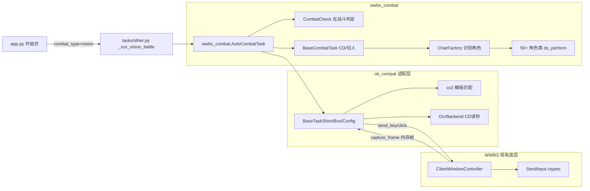

## 需求概述
将 ok-wuthering-waves（okww）的图像识别自动战斗能力移植到 WWBS 项目中。

## Product Overview
WWBS 已在 UI 中预留“图像识别”战斗类型（`COMBAT_TYPES["vision"]`），当前选择该类型会在战斗前中止。本次移植后，用户在开始页选择“图像识别”战斗类型时，系统将以 okww 的闭环方式作战：截图感知 → 识别战斗状态/当前角色 → 状态驱动连招决策 → SendInput 执行按键，循环直至战斗结束。

## Core Features
- **在战斗中检测**：移植 CombatCheck 状态机（F 破防提示、目标锁定金圈、血条检测、大招动画、进战斗判定），替代现有开环“时间轴假打”
- **角色识别与连招**：移植 CharFactory 注册表 + 全部 50+ 角色类（每个角色一套硬编码 `do_perform` 连招），识别队伍三名角色并按对应连招自动释放
- **技能 CD 读秒识别**：移植 refresh_cd/get_cd 的 CD OCR（`\d{1,2}\.\d` 正则），技能可用性判断（图标灰度 + CD 读秒），技能释放更精准
- **切人策略**：按 buff 剩余、协奏环满、入场动画优先级的智能切人（switch_next_char）
- **任务链接入**：打通 UI“图像识别”选项 → tasks/other.py → 战斗执行循环，复用现有 stop_event / input_lock / Ctrl+Alt+S 紧急停止
- 明确范围外：YOLO 声骸拾取（echo.onnx）、深渊计时、周年外围任务不移植


## Tech Stack
- 目标项目：Python + Tkinter（WWBS 现有栈），保留 Pillow + numpy，**新增 opencv-python、onnxruntime**
- 不引入 ok-script；新建 `wwbs_combat/` 适配层包实现 ok-script API 面（`next_frame/find_one/find_best_match_in_box/find_boxes/ocr/send_key/click/middle_click/box_of_screen/wait/Config/Box`）
- OCR：可插拔 OcrBackend，默认后端包装现有 `WindowsOcr`（零新依赖），预留 onnxocr-ppocrv6 后端接口；CD 解析用 `cd_regex = r'\d{1,2}\.\d'`
- 模板匹配：适配层用 cv2.matchTemplate（okww 约 500 张模板按 720p 归一缩放），WWBS 原 `image_matcher.TemplateMatcher` 保持不动

## Implementation Approach
1. **适配层方案**：okww 战斗代码 100+ 文件几乎全部 `from ok import ...`，直接重写不可行；方案是新建 `wwbs_combat/ok_compat/` 提供 ok-script 兼容垫片，使 okww 的 CombatCheck/BaseCombatTask/角色类**近乎原样移植**（仅改 import 来源），后续 okww 更新可低成本同步。
2. **内存帧截图**：为 `ClientWindowController` 新增 `capture_frame() -> numpy BGR`（复用现有窗口定位，不走磁盘），适配层 `next_frame()` 直接消费内存帧，消除现有“截图→磁盘→重读”延迟瓶颈（目标感知循环 ≥30fps）。
3. **线程模型**：vision 战斗在主任务 worker 线程内跑 `while in_combat(): get_current_char().perform()` 循环（对齐 okww TriggerTask 范式），输入经 `controller._input_lock`，stop_event/Ctrl+Alt+S 快停全程贯通；不新建 IdleAttackWorker（连招自带普攻）。
4. **裁剪而非全搬**：BaseCombatTask 约 1600 行中深渊计时、声骸相关逻辑移除，保留战斗判定/CD/切人/复活。
5. **性能与可靠性**：模板匹配按 box 区域裁剪匹配（避免全屏遍历）、模板启动时预热；识别失败/窗口丢失有安全兜底（释放按键、停止任务）；all role classes 为纯逻辑文件，零修改搬移。

## Architecture Design


## Directory Structure
```
e:/PythonProject/WWBS/
├── requirements.txt                      # [MODIFY] 新增 opencv-python、onnxruntime
├── windows_client.py                     # [MODIFY] 新增 capture_frame() 内存帧截图（保持 screencap 兼容）
├── assets/
│   └── okww_templates/                   # [NEW] 复制 okww assets/templates 中战斗所需模板（角色头像/技能图标/F提示/血条等）
├── wwbs_combat/                          # [NEW] okww 战斗移植包
│   ├── __init__.py                       # [NEW] 对外入口 VisionCombatRunner
│   ├── ok_compat/
│   │   ├── box.py                        # [NEW] Box 类 + box_of_screen 分辨率归一（target_height=720）
│   │   ├── matcher.py                    # [NEW] cv2 封装：find_one/find_best_match_in_box/find_boxes/wait_feature、模板缓存预热
│   │   ├── ocr.py                        # [NEW] OcrBackend 接口 + WindowsOcr 后端包装 + cd 数字解析；预留 onnxocr 后端
│   │   ├── task_shim.py                  # [NEW] BaseTaskShim：next_frame/screenshot/wait/send_key/click/middle_click（桥接 ClientWindowController）/info_set/Config 字典
│   │   └── hotkeys.py                    # [NEW] Game Hotkey 默认配置（Echo/Liberation/Resonance/Jump/Dodge/Wheel）
│   ├── combat/CombatCheck.py             # [NEW] 移植自 okww，import 改指 ok_compat
│   ├── task/BaseCombatTask.py            # [NEW] 移植并裁剪（去深渊/声骸），CD OCR + 切人策略保留
│   ├── task/BaseWWTask.py                # [NEW] 移植 in_team/in_world 场景判定
│   ├── task/AutoCombatTask.py            # [NEW] 改为接收 stop_event/input_lock 的 WWBS 线程模型循环
│   ├── scene/WWScene.py                  # [NEW] 原样移植
│   ├── Labels.py                         # [NEW] 原样移植
│   └── char/                             # [NEW] 全部 50+ 角色类 + BaseChar + CharFactory（import 改指 ok_compat）
├── tasks/other.py                        # [MODIFY] _check_combat_type 放行 vision；新增 _run_vision_battle 调 VisionCombatRunner
└── app.py                                # [MODIFY] 移除"图像识别战斗尚未实现"中止日志，vision 类型走真实执行链
```

## Key Code Structures
```python
# wwbs_combat/ok_compat/task_shim.py —— ok-script API 垫片（核心契约，移植代码全依赖此面）
class BaseTaskShim:
    def next_frame(self): ...                 # 阻塞至下一内存帧（ClientWindowController.capture_frame）
    def find_one(self, feature, box=None, threshold=...): ...
    def find_best_match_in_box(self, features, box, threshold=...): ...
    def box_of_screen(self, x1, y1, x2, y2): ...   # 720p 归一坐标换算
    def send_key(self, key, interval=None): ...    # → controller.press_key / press_binding
    def middle_click(self, box=None): ...
    def ocr(self, box=None, match=None, frame_processor=None): ...

# wwbs_combat/ok_compat/ocr.py
class OcrBackend(Protocol):
    def recognize_digits(self, frame: np.ndarray, box: Box) -> list[str]: ...
# 默认实现 WindowsOcrBackend（包装现有 WindowsOcr，close/资源管理对齐现有模式）
```

## Implementation Notes
- **爆炸半径控制**：不改动 `image_matcher.py`、`combat_rotation.py` 轴战斗链路；vision 为新增并行分支，axis 行为完全不变。
- **性能**：适配层模板预加载 + LRU 缓存；匹配只在指定 box 内做（cv2.matchTemplate 区域裁剪）；OCR 仅在需要 CD 时按小区域调用，避免全屏 OCR。
- **可靠性**：所有按键经 `_input_lock`；异常/stop_event 时释放 `_held_keys`；窗口检测失败立即安全退出战斗循环并回报日志。
- **风险项**：Windows.Media.Ocr 对 UI 小号 CD 数字（如 "12.3"）识别可靠性需先用 tests/ 截图资产离线验证；不可靠则切 onnxocr-ppocrv6 后端（依赖已在方案中预留接口）。
- **兼容性**：opencv-python 与 WWBS numpy>=1.24 共存需锁版本（参照 okww：opencv 5.0.0.93 / numpy 2.5.2，安装后跑现有 tests 回归）。


## Agent Extensions
### SubAgent
- **code-explorer**
  - Purpose: 移植期间对 okww `src/char/`、`BaseCombatTask.py` 中 ok-script API 调用面做精确定位与枚举，确保 ok_compat 垫片覆盖完整；验证移植后的 import 改写无遗漏
  - Expected outcome: 输出完整 ok-script API 调用清单，垫片实现零遗漏
